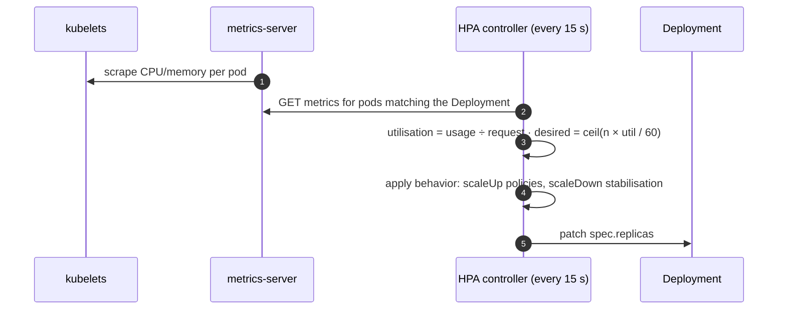
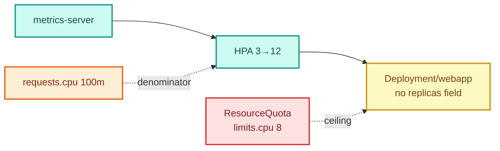

# Stage 13 — HorizontalPodAutoscaler

[⬅ Project 05](../../README.md) · Stage 8 of 10

[00 Namespace](../00-namespace/README.md) › [03 Deployments](../03-deployments/README.md) › [04 Services](../04-services/README.md) › [05 ConfigMaps](../05-configmaps/README.md) › [09 Ingress](../09-ingress/README.md) › [11 Rollouts](../11-health-checks/README.md) › [12 Resources](../12-resources/README.md) › **13 HPA** › [14 PDB](../14-pdb/README.md) › [19 Final](../19-final/README.md)

> **The problem:** three pods is right at one moment of the day and wrong at every other. Under a spike every pod
> sits at its 500m CPU limit and latency climbs; overnight the same three pods idle, paid for. Choosing the replica
> count by hand means being wrong twice a day.

---

## 1. WHY does this resource exist?

| Approach | Problem |
|---|---|
| Fixed replicas sized for peak | Paying for peak all day |
| Fixed replicas sized for average | Outage at peak |
| Humans running `kubectl scale` | Slow, and asleep at 3am |
| **HPA** | Replica count follows a metric, continuously |

The HPA scales **pods**, not **nodes**. If the new pods do not fit, they are `Pending` — adding nodes is the
Cluster Autoscaler's or Karpenter's job (Project 10).

---

## 2. WHAT is it?

An HPA is **a controller object that periodically sets a workload's `spec.replicas` from observed metrics.**

> **Analogy:** a store manager watching the checkout queue: open another till when every cashier is more than
> 60% busy, close one when they have been idle for a while — but never fewer than three, never more than twelve.

```
desired = ceil( currentReplicas × currentUtilisation / targetUtilisation )
utilisation = CPU usage ÷ CPU REQUEST
```

With a 100m request and a 60% target, a pod using 400m is at **400%**.

### Metrics Server

The HPA does not measure anything itself. It asks the `metrics.k8s.io` API, served by **Metrics Server**, which
scrapes each kubelet's resource summary. On this cluster it is the EKS community add-on from
`clusters/eks-advanced.yaml` — not installed on EKS by default.

---

## 3. HOW does it work?



**`behavior` in this project:**

| Direction | Policy | Effect |
|---|---|---|
| Up | `max(+100%, +2 pods) per 30 s`, no stabilisation | 3 → 6 → 12 in about a minute |
| Down | `−1 pod per 30 s`, after a 120 s stabilisation window | Leaves slowly; ignores brief dips |

---

## 4. Manifest

```yaml
# 01-webapp-hpa.yaml
apiVersion: autoscaling/v2
kind: HorizontalPodAutoscaler
spec:
  scaleTargetRef: { apiVersion: apps/v1, kind: Deployment, name: webapp }
  minReplicas: 3
  maxReplicas: 12
  metrics:
    - type: Resource
      resource: { name: cpu, target: { type: Utilization, averageUtilization: 60 } }
  behavior:
    scaleUp:
      stabilizationWindowSeconds: 0
      selectPolicy: Max
      policies:
        - { type: Percent, value: 100, periodSeconds: 30 }
        - { type: Pods,    value: 2,   periodSeconds: 30 }
    scaleDown:
      stabilizationWindowSeconds: 120
      policies:
        - { type: Pods, value: 1, periodSeconds: 30 }
```

And [`02-webapp-deployment.yaml`](02-webapp-deployment.yaml): **`spec.replicas` removed.** Plus
[`03-loadgen-deployment.yaml`](03-loadgen-deployment.yaml) at `replicas: 0`.

---

## 5. Manifest breakdown

| Field | Value | What breaks if it's wrong |
|---|---|---|
| `apiVersion` | `autoscaling/v2` | `v1` supports CPU only and no `behavior` |
| `averageUtilization` | `60` | % **of the request** — no request ⇒ `<unknown>` forever |
| `minReplicas` | 3 | The floor; also the PDB's working set in stage 14 |
| `maxReplicas` | 12 | Must fit the quota: 12 × 500m = 6 CPU ≤ `limits.cpu: 8` |
| `scaleDown.stabilizationWindowSeconds` | 120 | 0 ⇒ flapping on bursty traffic |
| Deployment `replicas` | **absent** | Present ⇒ every `kubectl apply` resets the HPA's decision |

---

## 6. Apply

```bash
kubectl apply -f manifests/13-hpa/
sleep 45
kubectl get hpa webapp-hpa -n web-platform
```

```
NAME         REFERENCE           TARGETS       MINPODS   MAXPODS   REPLICAS
webapp-hpa   Deployment/webapp   cpu: 2%/60%   3         12        3
```

---

## 7. Validate

```bash
kubectl top pods -n web-platform
kubectl describe hpa webapp-hpa -n web-platform | grep -A4 Conditions
```

▸ `AbleToScale True`, `ScalingActive True` — metrics are flowing.

---

## 8. Observe the mechanism — measured

```bash
kubectl scale deployment/loadgen -n web-platform --replicas=2
kubectl get hpa webapp-hpa -n web-platform -w          # Ctrl-C after ~4 min
kubectl logs deployment/loadgen -n web-platform --tail=3
```

Measured on this project's cluster:

```
t= 30s  replicas=3
t= 45s  replicas=6        ← +100% in one step
t= 75s  replicas=12       ← +100% again, then capped
…
Normal  SuccessfulRescale  New size: 6;  reason: cpu resource utilization (percentage of request) above target
Normal  SuccessfulRescale  New size: 12; reason: cpu resource utilization (percentage of request) above target
```

```bash
kubectl get hpa webapp-hpa -n web-platform -o jsonpath='{.status.currentMetrics[0].resource.current.averageUtilization}%{"\n"}'
kubectl describe hpa webapp-hpa -n web-platform | grep ScalingLimited
```

```
402%
ScalingLimited  True  TooManyReplicas  the desired replica count is more than the maximum replica count
```

▸ At 12 pods each was still using ~350–410m — **402% of its request**. The HPA wanted more and `maxReplicas`
stopped it. That is either the right ceiling (cost) or a sign `maxReplicas` is too low (latency). Read the
condition, not just the replica count.

Now stop the load and time the way down:

```bash
kubectl scale deployment/loadgen -n web-platform --replicas=0
```

```
t=205s replicas=11        ← nothing for 3+ minutes: the 120 s window, plus metric lag
t=342s replicas=10
t=376s replicas=9
t=411s replicas=8
…                          ← then roughly one pod every 30–35 s
```

▸ Up in about a minute, down over several — exactly the asymmetry the `behavior` block asked for.

---

## 9. Break it

### Break 1 — no request, no autoscaling

```bash
kubectl patch deployment webapp -n web-platform --type=json \
  -p '[{"op":"remove","path":"/spec/template/spec/containers/0/resources"}]'
kubectl rollout status deployment/webapp -n web-platform
kubectl get pods -n web-platform -l app.kubernetes.io/name=webapp -o jsonpath='{.items[0].spec.containers[0].resources}{"\n"}'
```

▸ The pods **still have requests** — the stage 12 LimitRange filled in `100m`. The HPA keeps working: the safety
net did its job. To see the classic `<unknown>` failure, delete the LimitRange first; then new pods have no request,
and `kubectl describe hpa` reports `failed to get cpu utilization: missing request for cpu`.

```bash
kubectl apply -f manifests/12-resources/01-limitrange.yaml -f manifests/13-hpa/02-webapp-deployment.yaml
```

### Break 2 — the manifest fights the autoscaler

```bash
kubectl scale deployment/loadgen -n web-platform --replicas=2; sleep 90
kubectl get hpa webapp-hpa -n web-platform                          # e.g. 12
kubectl apply -f manifests/12-resources/03-webapp-deployment.yaml   # has replicas: 3
kubectl get deployment webapp -n web-platform                       # 3 — for a moment
kubectl apply -f manifests/13-hpa/02-webapp-deployment.yaml
kubectl scale deployment/loadgen -n web-platform --replicas=0
```

▸ An `apply` of a manifest with `replicas: 3` drops a loaded service from 12 pods to 3 until the HPA's next
cycle puts them back. In a GitOps pipeline that re-applies every few minutes, this happens forever.

---

## 10. How it interacts



---

## 11. Production notes

> 🧪 **DEMO / LEARNING CONFIGURATION**
> CPU only, an in-cluster load generator, a low ceiling.

> 🏭 **PRODUCTION CONSIDERATIONS**
> - **Scale on the signal that hurts users**: requests per second or queue depth via custom/external metrics
>   (Prometheus Adapter, KEDA) — CPU is a proxy.
> - **Pair with node autoscaling** (Karpenter, Cluster Autoscaler) or the new pods go `Pending`.
> - **Headroom**: `minReplicas` sized for the load that arrives *faster* than pods start (warm-up + readiness).
> - **Never set `replicas`** in a manifest an HPA manages; in GitOps, ignore that field.

---

## 12. The next problem

Replicas now follow load. Now do maintenance: `kubectl drain` a node — as a node-group upgrade would — while
traffic flows. Nothing stops the drain evicting every webapp pod that happens to be on that node at once, and
nothing ensured the pods were spread across nodes in the first place.

→ **[Stage 14 — PodDisruptionBudget](../14-pdb/README.md)**

---

## 📚 Official documentation

Everything above is self-contained — these are for going deeper, not for filling gaps.
*(All links verified 2026-09-19.)*

| Reference | What it adds |
|---|---|
| [Horizontal Pod Autoscaling](https://kubernetes.io/docs/tasks/run-application/horizontal-pod-autoscale/) | The algorithm, `behavior`, and conditions |
| [HorizontalPodAutoscaler Walkthrough](https://kubernetes.io/docs/tasks/run-application/horizontal-pod-autoscale-walkthrough/) | A worked example |
| [Resource metrics pipeline](https://kubernetes.io/docs/tasks/debug/debug-cluster/resource-metrics-pipeline/) | How Metrics Server feeds the HPA and `kubectl top` |
| [Scale pod deployments with Horizontal Pod Autoscaler (EKS)](https://docs.aws.amazon.com/eks/latest/userguide/horizontal-pod-autoscaler.html) | The EKS view, including Metrics Server |

---

| ◀ Previous | ▲ Up | Next ▶ |
|---|:--:|---:|
| ◀ **[12 Resources](../12-resources/README.md)** | [Project 05](../../README.md) · [Manual steps](../../scripts/manual-steps.md) | **[14 PDB](../14-pdb/README.md)** ▶ |
