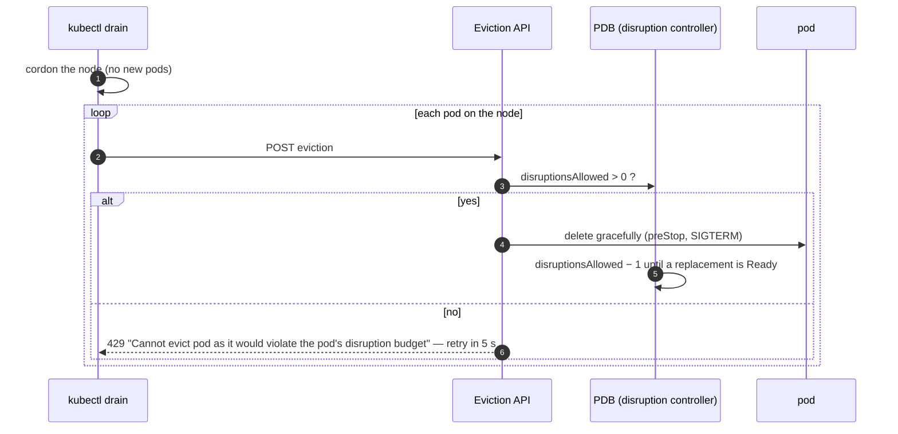
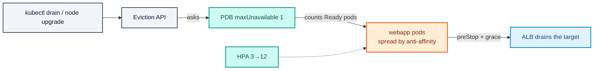

# Stage 14 — PodDisruptionBudget, drains, and spreading

[⬅ Project 05](../../README.md) · Stage 9 of 10

[00 Namespace](../00-namespace/README.md) › [03 Deployments](../03-deployments/README.md) › [04 Services](../04-services/README.md) › [05 ConfigMaps](../05-configmaps/README.md) › [09 Ingress](../09-ingress/README.md) › [11 Rollouts](../11-health-checks/README.md) › [12 Resources](../12-resources/README.md) › [13 HPA](../13-hpa/README.md) › **14 PDB** › [19 Final](../19-final/README.md)

> **The problem:** nodes need maintenance — AMI updates, node-group upgrades, the autoscaler removing an idle node.
> Each begins with `kubectl drain`, which evicts every pod on the node. If two of your three replicas are on it,
> both go at once, and nothing in the system knew that was a problem.

---

## 1. WHY does this resource exist?

| Disruption | Kind | Protected by a PDB? |
|---|---|---|
| `kubectl drain`, node-group upgrade, Cluster Autoscaler/Karpenter scale-in | **Voluntary** — goes through the Eviction API | ✅ |
| Node crash, kernel panic, AZ outage | Involuntary | ❌ — nobody asks |
| `kubectl delete pod` | Direct delete — bypasses eviction | ❌ |
| OOMKill, liveness restart | Container-level | ❌ |

A **PodDisruptionBudget** makes the Eviction API refuse any eviction that would leave the selected pods more than
the budget short. The drain simply waits and retries.

A PDB limits how fast pods **leave**. It says nothing about **where** they are — hence the second half of this
stage: spreading replicas across nodes, so an *involuntary* node loss also takes only a fraction.

---

## 2. WHAT is it?

A PDB is **a namespaced object selecting pods by label and stating how many may be voluntarily unavailable at
once** (`maxUnavailable`) or how many must stay available (`minAvailable`).

> **Analogy:** a hospital rota rule — "never more than one surgeon on leave at a time". Leave requests beyond that
> are not refused forever; they wait until someone comes back.

| Choice | Behaviour as the HPA scales 3 → 12 |
|---|---|
| **`maxUnavailable: 1`** — this project | Always exactly one at a time |
| `minAvailable: 2` | At 12 replicas, 10 may leave at once |
| `minAvailable: 3` at 3 replicas | **Zero** disruptions allowed — every drain blocks forever |

---

## 3. HOW does it work?



The disruption controller keeps `status.disruptionsAllowed` current: *ready pods − (pods required)*. A replacement
pod counts only once it is **Ready** — so probes (stage 11) are what make the budget meaningful.

---

## 4. Manifest

```yaml
# 01-webapp-pdb.yaml
apiVersion: policy/v1
kind: PodDisruptionBudget
spec:
  maxUnavailable: 1
  selector:
    matchLabels: { app.kubernetes.io/name: webapp, app.kubernetes.io/instance: webapp }
```

```yaml
# 02-webapp-deployment.yaml (the addition)
      affinity:
        podAntiAffinity:
          preferredDuringSchedulingIgnoredDuringExecution:
            - weight: 100
              podAffinityTerm:
                topologyKey: kubernetes.io/hostname
                labelSelector:
                  matchLabels: { app.kubernetes.io/name: webapp, app.kubernetes.io/instance: webapp }
```

---

## 5. Manifest breakdown

| Field | Value | What breaks if it's wrong |
|---|---|---|
| `apiVersion` | `policy/v1` | `v1beta1` is removed |
| `maxUnavailable` | `1` | `minAvailable` equal to replicas ⇒ drains block forever |
| `selector` | same labels as the Deployment's pods | Selects nothing ⇒ protects nothing, silently |
| anti-affinity `preferred…` | weight 100 | `required…` with 12 HPA replicas on 3 nodes ⇒ 9 pods `Pending` |
| `topologyKey` | `kubernetes.io/hostname` | `topology.kubernetes.io/zone` spreads by AZ instead (Project 09) |

---

## 6. Apply

```bash
kubectl apply -f manifests/14-pdb/
kubectl rollout status deployment/webapp -n web-platform
kubectl get pdb -n web-platform
```

```
NAME         MIN AVAILABLE   MAX UNAVAILABLE   ALLOWED DISRUPTIONS
webapp-pdb   N/A             1                 1
```

---

## 7. Validate

```bash
kubectl get pods -n web-platform -l app.kubernetes.io/name=webapp -o custom-columns=NAME:.metadata.name,NODE:.spec.nodeName
```

▸ Usually one pod per node. **Not always** — in this project's verification run, two pods shared a node right after
the rollout. *Preferred* anti-affinity is a scoring hint, weighed against everything else the scheduler considers;
only *required* is a guarantee (and has the costs in §5).

---

## 8. Observe the mechanism — a drain under load, measured

```bash
ALB=$(kubectl get ingress web-platform-ingress -n web-platform -o jsonpath='{.status.loadBalancer.ingress[0].hostname}')
docker run --rm cloudprakhargupta/web-platform:loadgen-1.0.0 --url "http://$ALB/api/info" --concurrency 24 --duration 150 &
NODE=$(kubectl get pods -n web-platform -l app.kubernetes.io/name=webapp -o jsonpath='{.items[0].spec.nodeName}')
kubectl drain "$NODE" --ignore-daemonsets --delete-emptydir-data --timeout=300s
wait
kubectl uncordon "$NODE"
```

Measured on this project's cluster:

```
evicting pod web-platform/webapp-5fd4dcd895-5jt92
evicting pod web-platform/webapp-597977664d-z4887
pod/webapp-597977664d-z4887 evicted
pod/webapp-5fd4dcd895-5jt92 evicted
node/ip-192-168-19-227.ec2.internal drained

TOTAL {'200': 6254}  success=6254/6254
```

▸ **Zero failures through the ALB while a node carrying two webapp pods was drained.** The PDB let one go, held the
other until a replacement was Ready elsewhere; each leaving pod ran its `preStop` (stage 11). The budget and the
graceful shutdown are one mechanism seen from two sides.

---

## 9. Break it

### Break 1 — a budget that allows nothing

```bash
kubectl patch pdb webapp-pdb -n web-platform --type merge -p '{"spec":{"maxUnavailable":null,"minAvailable":3}}'
kubectl get pdb webapp-pdb -n web-platform
NODE=$(kubectl get pods -n web-platform -l app.kubernetes.io/name=webapp -o jsonpath='{.items[0].spec.nodeName}')
timeout 40 kubectl drain "$NODE" --ignore-daemonsets --delete-emptydir-data
kubectl uncordon "$NODE"
```

```
webapp-pdb   3   N/A   0

error when evicting pods/"webapp-…" -n "web-platform" (will retry after 5s):
  Cannot evict pod as it would violate the pod's disruption budget.
```

▸ `ALLOWED DISRUPTIONS 0` — the drain retries every 5 s, forever. In a managed node-group upgrade this is the
upgrade that never finishes.

### Break 2 — `apply` cannot undo what `patch` added

Now restore the budget the obvious way:

```bash
kubectl apply -f manifests/14-pdb/01-webapp-pdb.yaml
```

```
The PodDisruptionBudget "webapp-pdb" is invalid: spec: … minAvailable and maxUnavailable cannot be both set
```

▸ Measured, and worth understanding. `kubectl apply` only removes fields **it** previously set. `minAvailable` was
added by `kubectl patch`, outside the applied configuration, so `apply` leaves it in place and adds
`maxUnavailable` — an invalid combination. Use `replace`, which sends the whole object:

```bash
kubectl replace -f manifests/14-pdb/01-webapp-pdb.yaml
```

The lesson generalises: imperative edits (`patch`, `edit`, `scale`, `set`) and declarative `apply` do not mix
cleanly. Server-side apply with field managers is the tool designed to track who owns which field.

---

## 10. How it interacts



---

## 11. Production notes

> 🧪 **DEMO / LEARNING CONFIGURATION**
> Hostname anti-affinity, three nodes, `maxUnavailable: 1`.

> 🏭 **PRODUCTION CONSIDERATIONS**
> - **A PDB for every multi-replica workload**, and never one that allows zero disruptions — it silently breaks
>   node upgrades.
> - **Topology spread across AZs** (`topologySpreadConstraints`) rather than hostname anti-affinity (Project 09).
> - **`unhealthyPodEvictionPolicy: AlwaysAllow`** so a PDB cannot block draining pods that are already broken.
> - **Single-replica workloads** cannot be both PDB-protected and drainable — run two, or accept the disruption.

---

## 12. The next problem

The platform is sized, autoscaled, budgeted and rolls without dropping requests. Rebuilding it means knowing that
the final Deployment is stage 14 layered on 13, 12 and 11, the Service selector changed in 11, the namespace label
is 11, the Ingress is 09 plus an annotation typed by hand — and that `webapp-config` is still **mutable**, so the
next edit reaches pods only as they happen to restart.

→ **[Stage 19 — The complete manifest](../19-final/README.md)**

---

## 📚 Official documentation

Everything above is self-contained — these are for going deeper, not for filling gaps.
*(All links verified 2026-09-19.)*

| Reference | What it adds |
|---|---|
| [Disruptions](https://kubernetes.io/docs/concepts/workloads/pods/disruptions/) | Voluntary vs involuntary, and how PDBs are evaluated |
| [Specifying a Disruption Budget for your Application](https://kubernetes.io/docs/tasks/run-application/configure-pdb/) | `minAvailable` vs `maxUnavailable`, worked through |
| [Safely Drain a Node](https://kubernetes.io/docs/tasks/administer-cluster/safely-drain-node/) | Cordon, drain, and the retry behaviour |
| [API-initiated Eviction](https://kubernetes.io/docs/concepts/scheduling-eviction/api-eviction/) | The 429 that makes a drain wait |
| [Update a managed node group (EKS)](https://docs.aws.amazon.com/eks/latest/userguide/update-managed-node-group.html) | Where PDBs meet EKS node upgrades |

---

| ◀ Previous | ▲ Up | Next ▶ |
|---|:--:|---:|
| ◀ **[13 HPA](../13-hpa/README.md)** | [Project 05](../../README.md) · [Manual steps](../../scripts/manual-steps.md) | **[19 Final](../19-final/README.md)** ▶ |
