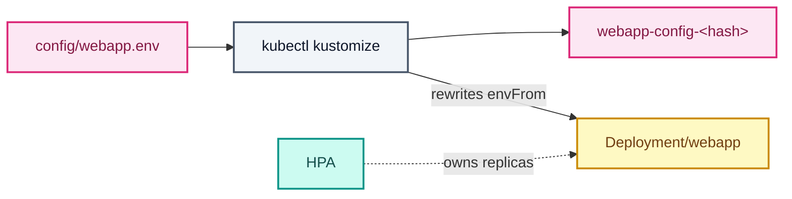

# Stage 19 — The complete manifest, with generated config

[⬅ Project 05](../../README.md) · Stage 10 of 10

[00 Namespace](../00-namespace/README.md) › [03 Deployments](../03-deployments/README.md) › [04 Services](../04-services/README.md) › [05 ConfigMaps](../05-configmaps/README.md) › [09 Ingress](../09-ingress/README.md) › [11 Rollouts](../11-health-checks/README.md) › [12 Resources](../12-resources/README.md) › [13 HPA](../13-hpa/README.md) › [14 PDB](../14-pdb/README.md) › **19 Final**

> **The problem:** the working platform is layered across nine directories, and `webapp-config` is still mutable —
> an edit reaches pods only as they happen to restart, with no revision to roll back to.

---

## 1. WHY combine now (and why generate config)?

| | Teaching stages | Operating |
|---|---|---|
| Files | One idea per stage | One desired state |
| Superseded versions | Kept, so you can see the change | Gone |
| Config change | Edit, then remember to restart | **A new name** ⇒ a revisioned rollout |

---

## 2. WHAT is Kustomize (and a configMapGenerator)?

Kustomize is built into `kubectl` (`-k`). A **configMapGenerator** builds `webapp-config-<hash>` from
[`config/webapp.env`](config/webapp.env), marks it immutable, and rewrites the Deployment's `envFrom` to that exact
name. Change a dial ⇒ new hash ⇒ new pod template ⇒ a rollout — with the zero-drop behaviour from stage 11 — and
`kubectl rollout undo` returns to the previous ConfigMap, which still exists.

---

## 3. HOW does it work here?

| In `complete-production-manifest.yaml` | From stage |
|---|---|
| Namespace with the readiness-gate label | 11 |
| `Service/webapp` selecting the application | 11 |
| LimitRange, ResourceQuota | 12 |
| Deployment: probes, preStop, grace, resources, anti-affinity, **no `replicas`** | 11–14 |
| HPA, loadgen (replicas 0) | 13 |
| PDB | 14 |
| Ingress | 09 |

**Absent:** the canary and blue/green demos, and the hand-written mutable ConfigMap.

| Field | What breaks if it's wrong |
|---|---|
| `configMapGenerator[].namespace` | Omitted ⇒ generated in your context's namespace |
| `includeSelectors: false` | `true` rewrites immutable selectors — every later apply fails |
| `images` | Retarget registries here, never in the manifest |

---

## 4. Manifest

[`kustomization.yaml`](kustomization.yaml), [`config/webapp.env`](config/webapp.env),
[`complete-production-manifest.yaml`](complete-production-manifest.yaml) (generated from the final stage files by
a script, so it cannot drift from them).

---

## 5. Manifest breakdown

```bash
kubectl kustomize manifests/19-final/ | grep '^kind:' | sort | uniq -c
```

```
      1 kind: ConfigMap        ← webapp-config-<hash>
      2 kind: Deployment       ← webapp, loadgen
      1 kind: HorizontalPodAutoscaler
      1 kind: Ingress
      1 kind: LimitRange
      1 kind: Namespace
      1 kind: PodDisruptionBudget
      1 kind: ResourceQuota
      1 kind: Service
```

---

## 6. Apply

```bash
MY_IP=$(curl -s https://checkip.amazonaws.com)
kubectl kustomize manifests/19-final/ | sed "s#inbound-cidrs: 0.0.0.0/0#inbound-cidrs: ${MY_IP}/32#" | kubectl apply -f -
kubectl delete configmap webapp-config -n web-platform --ignore-not-found
```

▸ **This is what `scripts/deploy.sh` does**, plus prerequisite checks — and one wait worth understanding: because
the Deployment has no `replicas` field, it is created with **one** pod and `rollout status` returns as soon as that
pod is ready. `deploy.sh` then waits until the HPA has raised it to `minReplicas` and those pods are Ready too.
Without that wait, `validate.sh` raced the autoscaler in this project's first verification run and reported 1/3.

---

## 7. Validate

```bash
./scripts/validate.sh
```

Every check — Burstable QoS, preStop inside the grace period, HPA seeing metrics, no `replicas` in the applied
manifest, one disruption allowed, the ALB answering — passed on a freshly created namespace in this project's
verification run.

---

## 8. Observe the mechanism

```bash
sed -i 's/^STARTUP_DELAY_SECONDS=8$/STARTUP_DELAY_SECONDS=4/' manifests/19-final/config/webapp.env
kubectl kustomize manifests/19-final/ | grep -m1 'name: webapp-config-'
# apply as in §6, then:
kubectl rollout history deployment/webapp -n web-platform
kubectl rollout undo deployment/webapp -n web-platform
git checkout manifests/19-final/config/webapp.env
```

▸ A new hashed name, a new revision, and an undo that restores the previous config.

---

## 9. Break it

```bash
CM=$(kubectl get deploy webapp -n web-platform -o jsonpath='{.spec.template.spec.containers[0].envFrom[0].configMapRef.name}')
kubectl patch configmap "$CM" -n web-platform --type merge -p '{"data":{"STARTUP_DELAY_SECONDS":"60"}}'
```

▸ `field is immutable when immutable is set` — the mutable-config trap from stage 05 no longer exists.

---

## 10. How it interacts



---

## 11. Production notes

> 🧪 **DEMO / LEARNING CONFIGURATION**
> One kustomization, your IP substituted with `sed`, a load generator shipped next to the app.

> 🏭 **PRODUCTION CONSIDERATIONS**
> - Base + overlays per environment, delivered by GitOps with pruning, and `replicas` ignored for HPA-managed
>   workloads (Project 10).
> - Load generation from outside the cluster, in CI, against a staging environment.

---

## 12. The next problem

This platform is ready for production traffic on a single service. What it does not do is run **work that
finishes** (Project 06), restrict **who** can act on it (Project 07), show you **why** it is slow beyond
`kubectl top` (Project 08), or survive an **AZ** going away (Project 09). Projects 06–09 can be taken in any order.

→ **[Roadmap — Projects 06–09](../../../docs/ROADMAP.md)**

---

## 📚 Official documentation

Everything above is self-contained — these are for going deeper, not for filling gaps.
*(All links verified 2026-09-19.)*

| Reference | What it adds |
|---|---|
| [configMapGenerator](https://kubectl.docs.kubernetes.io/references/kustomize/kustomization/configmapgenerator/) | Generator options |
| [Declarative Management of Kubernetes Objects Using Kustomize](https://kubernetes.io/docs/tasks/manage-kubernetes-objects/kustomization/) | Kustomize in kubectl |
| [Horizontal Pod Autoscaling](https://kubernetes.io/docs/tasks/run-application/horizontal-pod-autoscale/) | Why `replicas` must not be managed twice |

---

| ◀ Previous | ▲ Up | Next ▶ |
|---|:--:|---:|
| ◀ **[14 PDB](../14-pdb/README.md)** | [Project 05](../../README.md) · [Manual steps](../../scripts/manual-steps.md) | **[Roadmap](../../../docs/ROADMAP.md)** ▶ |
